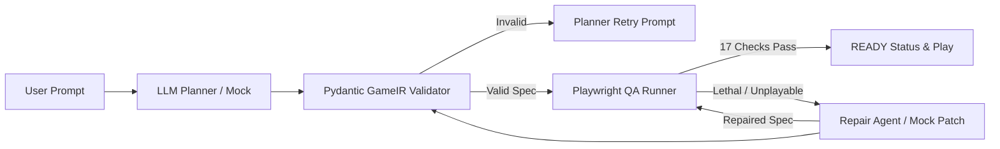

# AETHER: AI-Driven 2D Arena Survival Synthesis Engine (60% Milestone)

[](#automated-testing)
[](#spec-level-qa-verification)
[](#frontend-verification)
[](#milestone-scope)

AETHER synthesizes structured, deterministic, and fully playable 2D arena survival games directly from natural language prompts. It couples an LLM planner with strict GameIR schema validation, a deterministic Phaser 3 game client, automated headless browser QA testing (17 spec-level checks), and a bounded parameter-repair loop that diagnoses and repairs unplayable physics parameters before human handoff.

---

## Architecture Overview



1. **Natural Language Planner**: Translates arbitrary user prompts into strict, validated JSON complying with `GameIR v1.0`.
2. **Deterministic Browser Client**: Phaser 3 Arcade physics engine adhering to standard tick rates, seeded RNG, standard canvas dimensions (800x600), and a structured `window.__AETHER_GAME__` QA test harness hook.
3. **Automated QA Verification**: 17 spec-level browser checks running via Playwright to verify canvas rendering, movement speeds, collision responses, survival margins, win/loss reachability, and restart state isolation.
4. **Bounded Repair Loop**: Catches lethal or unplayable parameter sets (e.g. idle survival < 3.0s or flee-bot failure) and applies targeted numeric patches to achieve Playable@3.

---

## System Requirements & Prerequisites (Windows PowerShell)

- **Operating System**: Windows 10 or Windows 11 (tested on PowerShell 5.1 & PowerShell 7)
- **Python**: Version 3.11+ (virtual environment required)
- **Node.js**: Version 18.0+ or 20.0+ (with `npm`)
- **Web Browser**: Google Chrome or Chromium (managed automatically by Playwright)

---

## Setup & Installation (Blueprint 15.1)

### 1. Backend Setup
```powershell
# Navigate to the backend directory
cd aether-backend

# Create virtual environment
python -m venv venv

# Activate virtual environment
.\venv\Scripts\Activate.ps1

# Install required dependencies
pip install -r requirements.txt

# Install Playwright browser binaries
playwright install chromium
```

### 2. Frontend Setup
```powershell
# Navigate to frontend directory
cd ..\aether-frontend

# Clean install node dependencies
npm ci
```

### 3. Environment Configuration (`.env`)
Copy the provided `.env.example` to `aether-backend\.env`:
```powershell
cp aether-backend\.env.example aether-backend\.env
```

Configuration variables explained:
```dotenv
# Provider selection: 'mock' for local offline testing, 'openai_compat' for Google AI Studio
MODEL_PROVIDER=openai_compat

# Google AI Studio Gemini API Key (keep secret; never commit to git)
MODEL_API_KEY=your_gemini_api_key_here

# Base URL for Gemini OpenAI-compatible endpoint
MODEL_BASE_URL=https://generativelanguage.googleapis.com/v1beta/openai/

# Primary model identifier
MODEL_NAME=gemini-3.5-flash-lite

# Automatic fallback chain (comma-separated fallback models used upon quota 429 exhaustion)
MODEL_FALLBACKS=gemini-3.7-flash,gemini-3.6-flash,gemini-3.5-flash-lite,gemini-3.1-flash-lite

# Request timeout in seconds
MODEL_TIMEOUT_SECONDS=60.0
```

> [!SECURITY NOTE]
> Never check `.env` into git. The repository `.gitignore` explicitly excludes `.env` and `.env.*`. Only `.env.example` is tracked.

---

## Quick Launch Commands

| Action | PowerShell Command |
|---|---|
| **Launch Offline Mock Demo** | `powershell -ExecutionPolicy Bypass -File scripts\start_all.ps1 -Mock` |
| **Launch Live Gemini Demo** | `powershell -ExecutionPolicy Bypass -File scripts\start_all.ps1` |
| **Stop All Background Services** | `powershell -ExecutionPolicy Bypass -File scripts\stop_all.ps1` |
| **Run Backend Pytest Suite (137 tests)** | `aether-backend\venv\Scripts\python.exe -m pytest aether-backend\tests` |
| **Run Baseline Browser QA (4 Modes)** | `aether-backend\venv\Scripts\python.exe scripts\run_qa_all.py` |
| **Run Variety Browser QA (5 Modes)** | `aether-backend\venv\Scripts\python.exe scripts\run_variety_qa.py` |
| **Run Broken Fixtures Validation (3)** | `aether-backend\venv\Scripts\python.exe scripts\run_qa_fixtures.py` |
| **Run Full Evaluation Benchmark** | `powershell -ExecutionPolicy Bypass -File scripts\run_real_eval.ps1 -Mock` |

---

## Repository Structure

```
AETHER_V3/
├── aether-backend/             # FastAPI service, orchestrator, planners & QA
│   ├── bench/                  # Canonical benchmark prompts (12 prompts)
│   ├── providers/              # Model providers (openai_compat, mock)
│   ├── schemas/                # Pydantic GameIR schemas
│   ├── services/               # Orchestrator, qa_runner, repair, validator
│   └── tests/                  # 137 automated pytest suites

├── aether-frontend/            # Vite + React + TypeScript + Phaser 3 client
│   ├── public/fallback/        # Bundled offline demo artifacts
│   └── src/
│       ├── components/         # GlassPanel, SynthesisTerminal, QADrawer
│       ├── game/               # ArenaScene.ts, Phaser game engine, GameIR
│       └── pages/              # Forge.tsx (synthesis), PlayGame.tsx (canvas)
├── docs/                       # Technical specifications & benchmark evidence
│   ├── PROJECT_GUIDE.md        # Comprehensive system & onboarding manual
│   ├── HANDOVER.md             # Teammate handover reference guide
│   ├── DEMO_RUNBOOK.md         # Stage rehearsal runbook
│   ├── EVAL_RESULTS.md         # Multi-model evaluation report
│   ├── HOW_TO_RUN.md           # Step-by-step PowerShell execution guide
│   ├── QA_CHECKS.md            # Detailed spec of all 17 QA checks
│   └── REPAIR_LOOP.md          # Bounded parameter repair specifications
└── scripts/                    # Automation, eval harness, and verification tools
```
