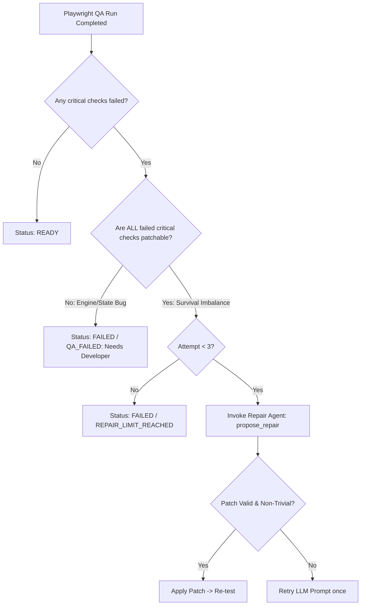

# AETHER Bounded Parameter Self-Repair Loop

This document specifies the architecture, decision policy, prompt mechanics, and empirical verification of the AETHER automated self-repair loop (`services/repair.py`).

---

## 1. Problem Formulation

LLMs frequently generate game specifications that are syntactically valid JSON and satisfy all isolated schema bounds, but are **mechanically unplayable** in real-time execution. For example:
- Generating 40 chasers moving at 240 px/s when the player only moves at 150 px/s with 1 HP causes player death in under 1.5 seconds.
- An evasion bot cannot survive even 3 seconds when enemy density saturates the arena.

Rather than rejecting the user's narrative intent or delivering a broken game, AETHER uses closed-loop automated QA feedback to diagnose playability failures and apply targeted numeric adjustments before human delivery.

---

## 2. Decision Policy & Guardrails

The orchestrator enforces strict boundaries before initiating repair:



### Policy Rules:
1. **Patchable-Only Gate**: Repair is triggered **only** if all failed critical checks belong to the patchable set: `idle_survival_min_seconds` and `flee_bot_survives`.
2. **Fast-Fail on Engine Bugs**: If any runtime or engine check fails (such as canvas stalling, player velocity inconsistency, or restart state corruption), repair is skipped immediately. The system logs `"needs developer"` and transitions to `FAILED`.
3. **Hard Bounded Attempts**: Maximum **2 repair cycles** (total of 3 test attempts). If a spec remains unplayable after attempt 3, the job enters terminal state `FAILED` (`REPAIR_LIMIT_REACHED`).

---

## 3. Repair Agent Contract & Implementation

### 3.1 Function Signature
```python
def propose_repair(
    spec: GameIR,
    qa_report: Dict[str, Any],
    provider: BaseModelProvider
) -> RepairResult:
    """
    Synthesizes a minimal GameIRPatch to fix failed QA checks.
    Returns RepairResult(patch=..., rationale=..., errors=...).
    """
```

### 3.2 System Prompt & Constraints
The repair agent prompt informs the model:
1. **Context**: You are repairing an unplayable game specification. The current game failed spec-level QA checks.
2. **Failure Details**: The exact measured survival seconds and required thresholds are provided.
3. **Allowed Adjustments**:
   - `player_move_speed`: Boost player agility up to 300.0 px/s.
   - `player_max_health`: Increase player resilience up to 10 HP.
   - `enemy_speed_multiplier`: Scale down enemy pursuit velocity (e.g. 0.6x to 0.85x).
   - `enemy_count`: Reduce active enemy pressure down to manageable levels.
   - `objective_target`: Scale down impossible survival durations or item counts.
4. **Strict Invariants**:
   - MUST NOT change the game genre (`arena_survival`).
   - MUST NOT change the theme (`fantasy`, `sci_fi`, etc.).
   - MUST NOT alter the title or narrative premise.
   - MUST NOT change the objective type (e.g. cannot convert survival into collection).
   - MUST NOT change the player's attack mode (cannot give weapons to an avoid-only game).
   - MUST output raw JSON conforming strictly to `GameIRPatch` with `extra="forbid"`.

### 3.3 No-Op Patch Rejection
If the LLM returns an empty patch or parameters identical to the failing spec, the repair service rejects the proposal and triggers a single re-prompt requesting meaningful parameter differentiation.

---

## 4. Empirical Evidence from Real Evaluation Runs

All numbers cited below are taken directly from committed evaluation artifacts:

### 4.1 Run A2 (`docs/eval/eval_openai_compat_gemini-3.5-flash-lite_20261014_134751.json`)
- **Model**: `gemini-3.5-flash-lite` via `openai_compat`.
- **Target**: Stress prompts designed to produce intentionally unplayable initial specifications.
- **Results**:
  - `s01` ("impossible bullet-hell arena with 50 pursuers moving twice the player's speed, zero recovery, and 1 hit point"):
    - Attempt 1: Failed `idle_survival_min_seconds` (player died in 1.2s) and `flee_bot_survives`.
    - Repair 1: Increased player health from 1 to 4, reduced enemy speed multiplier to 0.70x.
    - Attempt 2: **ALL 17 QA CHECKS PASSED**. Game reached `READY` in 76.7s.
  - `s02` ("extremely brutal survival nightmare with 45 lethal chaser monsters moving at maximum speed in a tiny arena with only 1 health"):
    - Attempt 1: Failed `idle_survival_min_seconds` and `flee_bot_survives`.
    - Repair 1: Reduced enemy count from 45 to 16, increased player health from 1 to 5.
    - Attempt 2: **ALL 17 QA CHECKS PASSED**. Game reached `READY` in 75.3s.
  - **Repair Success Rate**: **2/2 (100.0%)**.

### 4.2 Mock Evaluation Run (`docs/eval/eval_mock_mock_20261014_142213.json`)
- Evaluated on `p06` ("difficult high-stakes arena with slow player and extreme enemy speeds"):
  - Attempt 1: Failed idle survival.
  - Repair 1: Applied deterministic parameter patch.
  - Attempt 2: Passed all 17 QA checks (`READY` in 87.1s).
  - Playable@1: 90.9% (10/11) $\rightarrow$ Playable@3: **100.0% (11/11)**.
