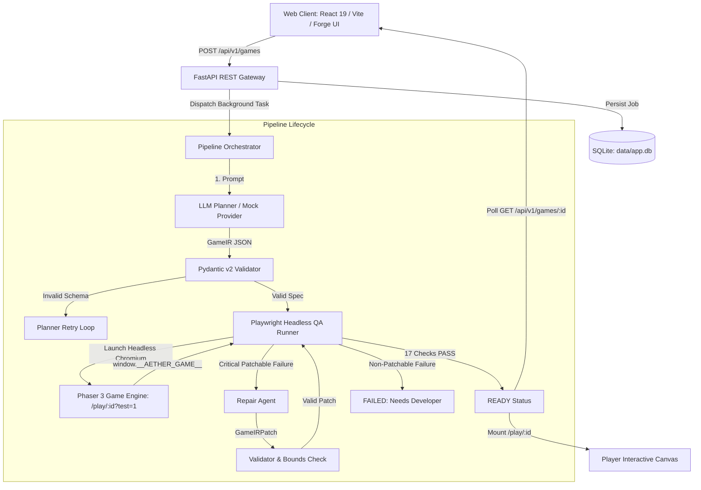
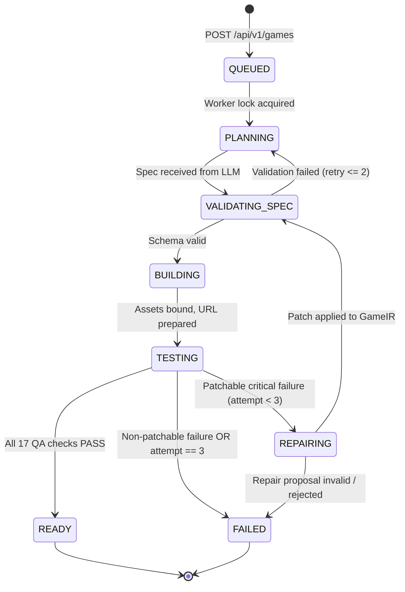

# AETHER Architecture Specification

This document details the architectural design, system decomposition, state machine transitions, concurrency control, and data models of the AETHER Game Synthesis and Self-Repair Engine (60% Milestone).

---

## 1. System Overview

AETHER bridges high-level natural language intent and low-level deterministic 2D game execution through a multi-stage synthesis and verification pipeline.



---

## 2. Job State Machine & Lifecycle

Every generation job follows an explicit state machine managed by `aether-backend/services/orchestrator.py`:



### State Definitions:
- **`QUEUED`**: Job registered in database; waiting for the single active execution lock.
- **`PLANNING`**: Prompt sent to LLM provider (`openai_compat` or `mock`).
- **`VALIDATING_SPEC`**: Validating generated JSON against Pydantic `GameIR` schema.
- **`BUILDING`**: Writing spec artifacts and generating testable URL.
- **`TESTING`**: Headless Chromium instance running 17 spec-level QA checks via Playwright.
- **`REPAIRING`**: Lethal or unplayable parameters diagnosed; LLM repair agent generates parameter patch.
- **`READY`**: All critical checks pass; game is playable.
- **`READY_WITH_WARNINGS`**: Critical checks pass, but non-critical check (e.g. screenshot captured) had a warning.
- **`FAILED`**: Terminal failure with descriptive `error_code` and user-friendly explanation.

---

## 3. Concurrency & Queue Model

1. **Single-Worker Concurrency Limit**:
   - To prevent GPU/memory contention in headless Playwright sessions and respect LLM free-tier rate limits, AETHER enforces a strict concurrency limit of **1 active processing job**.
   - Additional requests remain in state `QUEUED` until the active job completes or fails.
2. **Crash & Restart Recovery**:
   - On backend application startup (`main.py` lifespan), any job found in non-terminal states (`PLANNING`, `VALIDATING_SPEC`, `BUILDING`, `TESTING`, `REPAIRING`) is immediately marked `FAILED` with error code `INTERNAL_ERROR` and detail `"interrupted by server restart"`.
   - Jobs are never left permanently running or stuck.

---

## 4. Subsystems Decomposition

### 4.1 FastAPI Backend Gateway (`aether-backend/`)
- **`main.py`**: Initializes FastAPI application, registers routers, applies CORS middleware, mounts `/artifacts` static directory, and cleans stuck jobs on startup.
- **`routes/games_v1.py`**: Public RESTful API exposing `/api/v1/games`, `/spec`, `/qa`, `/events`, and `/health`.
- **`services/job_store.py`**: Persistent SQLite storage in `data/app.db` managing the `games` table.
- **`services/event_store.py`**: Persistent append-only event stream in `data/app.db` managing the `events` table with structured payloads (timestamps, stage, result, detail, attempt, rationale, before/after diffs).

### 4.2 LLM Provider Layer (`aether-backend/providers/`)
- **`providers/openai_compat.py`**: Generic HTTP client calling OpenAI-compatible `/chat/completions` endpoints (used for Google AI Studio Gemini API). Features:
  - Exponential backoff with jitter on HTTP 429 and 503.
  - Configurable request timeout (`MODEL_TIMEOUT_SECONDS`).
  - Automatic model fallback chain (`MODEL_FALLBACKS`).
- **`providers/mock.py`**: Deterministic offline provider producing valid GameIR specs and targeted repair patches for CI and offline development.

### 4.3 Game Specification Layer (`aether-backend/schemas/game_ir.py`)
- Pydantic v2 data models with strict bounds, enumerated types, and forbidden extra fields:
  - `GameIR`: Complete specification contract.
  - `GameIRPatch`: Numeric delta schema restricted to patchable physics parameters.
- **`services/validator.py`**: Syntactic and semantic validator verifying arena dimension consistency, speed bounds, and objective sanity.

### 4.4 Browser QA Automation (`aether-backend/services/qa_runner.py`)
- Headless Chromium runner executing Playwright Sync API against `/play/:id?test=1`.
- Executes **17 spec-level browser checks**:
  - Validates WebGL/Canvas rendering.
  - Asserts tick counter progression.
  - Drives player movement via real keyboard dispatch.
  - Measures straight, diagonal, and wall-slide velocities.
  - Evaluates idle survival time and flee-bot evasion survival.
  - Verifies win and lose state reachability.
  - Verifies state isolation and absence of memory/zombie leaks across keyboard restarts.

### 4.5 Game Client Engine (`aether-frontend/src/game/`)
- Built with **Phaser 3.90** Arcade Physics within a React 19 container.
- Standard 800x600 arena with deterministic 60Hz tick loop.
- Exposes `window.__AETHER_GAME__` test harness hook strictly when `?test=1` query parameter is present.

---

## 5. Artifact Storage Hierarchy

Every generated game persists complete traceability artifacts in `aether-backend/artifacts/<game_id>/`:
```
artifacts/
└── <game_id>/
    ├── game_ir_v1.json            # Initial generated GameIR specification
    ├── game_ir_v2.json            # Repaired GameIR specification (if repair triggered)
    ├── qa_report_attempt_1.json   # Full QA report for first test attempt
    ├── qa_report_attempt_2.json   # Full QA report for post-repair test attempt
    ├── agent_trace.jsonl          # Comprehensive pipeline execution audit trail
    └── screenshots/
        └── <game_id>.png          # Headless Playwright canvas capture
```
